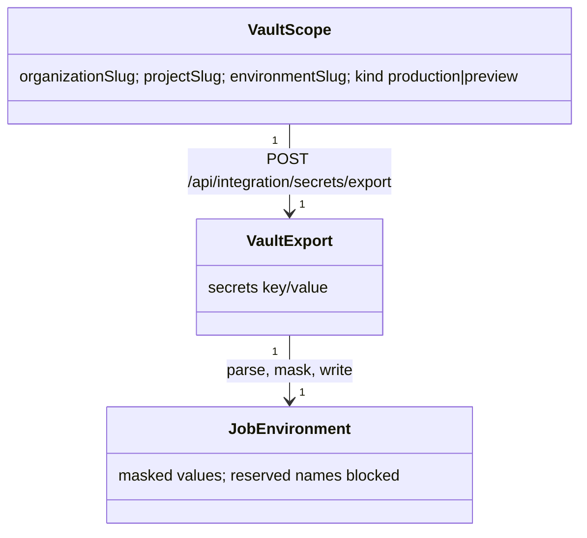

# AGENTS.md — actions

## Overview

`thecodeorigin/actions`: shared GitHub composite actions. Currently one action, `vault-environment` (`vault-environment/{action.yml,index.mjs}`),
that loads a scoped THECODEORIGIN Vault environment into a CI job. No Nuxt app, no dev port, no domain, no database.

## Working rules

- Callers store one repository secret, `THECODEORIGIN_VAULT_TOKEN`; app and deployment credentials live in the `thecodeorigin-co-ltd`
  Vault organization, and each token should reach only the project environments its workflow needs.
- Pin callers to a reviewed full commit SHA of this repo and pass named secrets explicitly. Each repository deploys through its own workflows.
- Usage: `uses: thecodeorigin/actions/vault-environment@<sha>` with `token`, `project` (Vault project slug, one per app), `environment`
  (`dev`/`production`), `deployment-kind` (`production` | `preview`), optional `keys` (JSON array to select keys).
- Security invariants in `index.mjs`: slugs validated (`parseScope`); `deployment-kind` must match the environment (`production` only
  with `production`; `preview` with dev/development/staging/preview); the endpoint must be an https `thecodeorigin.com` host with no port/path so the API key
  cannot be sent elsewhere (`exportEndpoint`); returned scope is validated, values are masked, and reserved/forbidden names (`GITHUB_*`, `RUNNER_*`,
  `PATH`, `NODE_OPTIONS`, `BASH_ENV`, ...) can never be written to the job environment. The Vault token is visible only to the loader step.
- Also imported as a module by tooling: `readVaultEnvironment` from `configs/actions/vault-environment/index.mjs`.

## Roles and abilities

No roles; not an ID relying party. It authenticates to Vault with an integration API key (`x-api-key`, `THECODEORIGIN_VAULT_TOKEN`) whose
reveal capability is scoped by Vault to specific project environments (see `apps/security/vault`).

### Platform roles

None.

### Application roles

None.

### API Key

None; this project does not issue or accept ID API keys. Its own credential is described above.

## Domain model

## Relationships with other apps

- Calls `apps/security/vault` (`https://vault.thecodeorigin.com/api/integration/secrets/export`) with the Vault API key.
- Used by every app's GitHub Actions workflows (CI, preview, deploy) and the root deployment workflow to load Cloudflare and app secrets.
